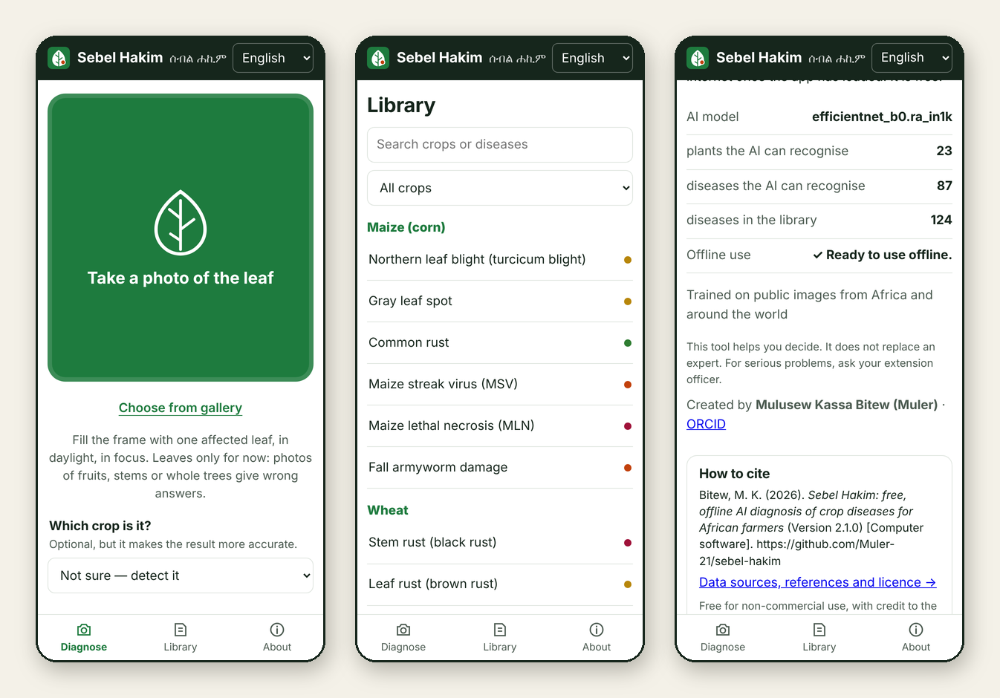
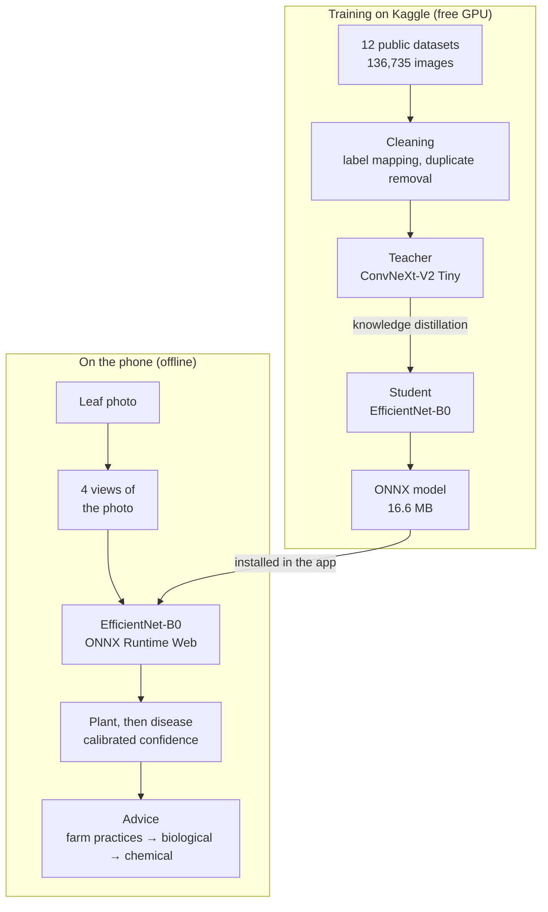

<div align="center">


# Sebel Hakim · ሰብል ሐኪም

### Free, offline AI diagnosis of crop diseases for African farmers

Photograph a leaf. The app names the plant and the most likely disease or pest, says how sure it is, and explains
what to do, starting with farm practices and using chemicals only as a last resort.

[](https://muler-21.github.io/sebel-hakim/)

[](#features)
[](#accuracy)
[](#features)
[](https://doi.org/10.5281/zenodo.24115009)
[](#how-to-cite)
[](#licence)
[](https://orcid.org/0000-0001-6223-0037)



**Created by [Mulusew Kassa Bitew](https://orcid.org/0000-0001-6223-0037)** ·
[How to cite](#how-to-cite) · [Data sources](#data-sources) · [Accuracy](#accuracy) · [Licence](#licence)

</div>

---

## Why

Plant pathogens and pests cost the world's major food crops an estimated 17–30% of their harvest, and the
highest losses occur in food-deficit regions with fast-growing populations ([Savary et al., 2019](#references)).
Most smallholder farmers cannot reach a plant-health expert quickly. Sebel Hakim gives them a first diagnosis in
seconds, for free, in their own language, and without internet.

## Features

- **Identifies the plant first, then the problem.** 108 classes across 23 crops, including Africa's priority
  threats: cassava mosaic and brown streak, maize lethal necrosis and streak virus, wheat stem and yellow rust,
  bean angular leaf spot, banana Fusarium wilt, bunchy top and black Sigatoka, coffee leaf rust, groundnut rosette.
- **Works offline.** After the first visit, the 16.6 MB model runs on the phone with ONNX Runtime Web (WebAssembly).
  No server, no data costs.
- **Answers in seconds.** The model looks at four views of the photo and combines them.
- **Honest about uncertainty.** Confidence is calibrated. Photos unlike the training data (fruits, whole trees,
  screenshots) are marked *only a guess*, and the user can correct the plant with one tap.
- **Advice in integrated-pest-management order.** Farm practices, then natural and biological options, then
  chemicals as a last resort (active ingredients only, never brand names), with symptoms, spread and prevention.
- **A library of 124 diseases, pests and disorders across 24 crops**, with scientific names, for students,
  researchers and extension agents.
- **Five languages:** English, Amharic, French, Swahili and Italian.
- **Private by design.** Photos never leave the phone. No account, no cookies; the only data collected is an
  anonymous page-view count ([GoatCounter](https://www.goatcounter.com)).

## How it works



| Step | Why |
|---|---|
| Many datasets; field photos weighted ×2, lab photos ×0.5 | models trained only on lab photos fail in real fields |
| Duplicate removal across datasets (perceptual hash) | the same photo can never be in both training and test, so scores are honest |
| Phone-like augmentation (crop, blur, colour, rotation, erasing), mixup and CutMix | survives bad light, shaky hands and cluttered backgrounds |
| Large teacher distilled into a small student | near-teacher accuracy at phone speed |
| Temperature scaling | "87% sure" really means about 87% |
| Plant-first ranking, view agreement and response-strength checks | fewer cross-crop mistakes; unfamiliar photos are flagged instead of answered confidently |

## Accuracy

Model v2 (October 2026), tested on **13,676 held-out photos** that were never used in training: 10% of every
dataset and class, after removing duplicates across datasets.

| Metric | v1 (60 classes) | **v2 (108 classes)** |
|---|---|---|
| Top-1 accuracy, all test photos | 93.4% | **93.9%** |
| Top-1 accuracy, field and internet photos | 87.9% | **90.3%** |
| Top-1 accuracy, lab photos | 99.5% | **99.5%** |
| Right answer among the top 3 | 98.7% | **98.6%** |
| Plant identified correctly | 96.8% | **97.5%** |
| Macro-F1, all / field | 0.888 / 0.705 | **0.864 / 0.784** |

v1 and v2 were tested on different test sets (11,404 and 13,676 photos), because v2 added datasets and classes.
The teacher model reaches 94.4% (90.9% on field photos). An int8-quantised version lost 8 points and is not used.

<details>
<summary><b>Accuracy per crop (test photos)</b></summary>

| Crop | Photos | Top-1 | Crop | Photos | Top-1 |
|---|---:|---:|---|---:|---:|
| Mango | 375 | 100.0% | Pepper | 304 | 94.7% |
| Sorghum | 328 | 99.7% | Squash | 255 | 94.5% |
| Strawberry | 201 | 99.0% | Tomato | 2,027 | 94.4% |
| Groundnut | 81 | 98.8% | Blueberry | 198 | 93.4% |
| Raspberry | 66 | 98.5% | Rice | 60 | 91.7% |
| Maize | 2,243 | 97.8% | Cherry | 252 | 91.3% |
| Citrus | 610 | 97.7% | Potato | 594 | 91.1% |
| Soybean | 588 | 97.1% | Apple | 464 | 90.5% |
| Grape | 488 | 96.9% | Cassava | 1,425 | 84.1% |
| Bean | 1,743 | 96.2% | Banana | 76 | 81.6% |
| Peach | 329 | 95.4% | Wheat | 113 | 81.4% |
| *Unknown plant* | 821 | 87.9% | Coffee | 35 | 80.0% |

Full reports, including per-dataset and per-class results and the most common confusions:
[`docs/model_v2/`](docs/model_v2/) (v1: [`docs/model_v1/`](docs/model_v1/)).

</details>

**Known limits.** Photos taken from the internet are harder than survey photos (PlantDoc 76%, PlantWild 75%).
Cassava diseases are confused with each other (84%). Banana, wheat and coffee have few test photos. Classes with
few photos score lower, which is why macro-F1 is below accuracy. Fruit photos are not supported yet: model v3
(next release) adds mango, guava and papaya fruit diseases.

## How to cite

If you use Sebel Hakim (the app, its trained model or its knowledge base) in research, teaching, extension
material or another project, please cite it:

> Bitew, M. K. (2026). *Sebel Hakim: Free, offline AI diagnosis of crop diseases for African farmers*
> (Version 2.1.0) [Computer software]. Zenodo. https://doi.org/10.5281/zenodo.24115009

```bibtex
@software{bitew_2026_sebel_hakim,
  author  = {Bitew, Mulusew Kassa},
  title   = {Sebel Hakim: Free, Offline {AI} Diagnosis of Crop Diseases for African Farmers},
  year    = {2026},
  version = {2.1.0},
  publisher = {Zenodo},
  doi     = {10.5281/zenodo.24115009},
  url     = {https://doi.org/10.5281/zenodo.24115009},
  note    = {Web app: https://muler-21.github.io/sebel-hakim/}
}
```

GitHub's **Cite this repository** button (right-hand sidebar) gives the same citation in APA and BibTeX, generated
from [`CITATION.cff`](CITATION.cff). Please also cite the datasets the model learned from (below).

## Data sources

Model v2 was trained on **136,735 images from 12 public datasets** (after duplicate removal and a cap of 6,000
images per class and dataset). The images are not redistributed here; each dataset keeps its own licence.
Sincere thanks to everyone who collected and labelled them.

| Dataset | Creators | Origin | Setting | Images used | Licence |
|---|---|---|---|---:|---|
| [PlantVillage](https://github.com/spMohanty/PlantVillage-Dataset) | Hughes & Salathé, 2015; Mohanty et al., 2016 | USA | lab | 54,275 | CC BY-SA 3.0 |
| [Healthy and diseased maize, Tanzania](https://doi.org/10.5281/zenodo.15685236) | Mduma, Laizer & Kiriba, 2025 (NM-AIST, TARI) | Tanzania | field | 17,365 | CC BY 4.0 |
| [PlantWild](https://tqwei05.github.io/PlantWild) | Wei et al., 2024 | internet | mixed | 17,013 | CC BY-NC-ND 4.0 |
| [Makerere University beans](https://doi.org/10.7910/DVN/TCKVEW) | Mugalu et al., 2022 | Uganda | field | 15,402 | CC0 1.0 |
| [Cassava Leaf Disease Classification](https://www.kaggle.com/competitions/cassava-leaf-disease-classification) | Makerere University AI Lab & NaCRRI, 2020 | Uganda | field | 14,239 | Kaggle rules (non-commercial) |
| [MangoLeafBD](https://doi.org/10.17632/hxsnvwty3r.1) | Ahmed et al., 2023 | Bangladesh | orchards | 3,758 | CC BY-NC 3.0 |
| [PlantSeg](https://doi.org/10.5281/zenodo.17719108) | Wei et al., 2025 | internet | mixed | 3,726 | CC BY-NC 4.0 |
| [Sorghum disease images](https://doi.org/10.17632/fgb3cmfrg2.1) | Thite & Patil, 2024 | not stated | field | 3,278 | CC BY 4.0 |
| [Potato leaf disease, uncontrolled environment](https://doi.org/10.17632/ptz377bwb8.1) | Shabrina et al., 2024 | Indonesia | field | 3,015 | CC BY 4.0 |
| [PlantDoc](https://github.com/pratikkayal/PlantDoc-Dataset) | Singh et al., 2020 | internet | mixed | 2,400 | CC BY 4.0 |
| [iBean](https://github.com/AI-Lab-Makerere/ibean) | Makerere AI Lab, 2020 | Uganda | field | 1,457 | MIT |
| [Groundnut leaf](https://doi.org/10.17632/x6x5jkk873.2) | Sasmal et al., 2024 | India | field | 807 | CC BY 4.0 |

### Added for model v3 (training pending)

| Dataset | Creators | Origin | Licence |
|---|---|---|---|
| [MangoDHDS: diseased and healthy mangoes](https://doi.org/10.17632/b4nrw5hyyc.1) | Barhate, Barhate & Joshi, 2025 | India | CC BY 4.0 |
| [Amrapali mango fruit diseases](https://doi.org/10.17632/ypttkp5fb5.1) | Alam, Noman & Ali, 2026 | Bangladesh | CC BY 4.0 |
| [Mango dataset (leaves, natural conditions)](https://doi.org/10.17632/fn8dgf4hb5.1) | Nirob et al., 2024 | Bangladesh | CC BY 4.0 |
| [ABCGMP fruit and leaf diseases, six crops](https://doi.org/10.17632/fhbvmpcyy2.3) | Jain, Nain & Jain, 2026 | India | CC BY 4.0 |
| [Guava fruits and leaves](https://doi.org/10.17632/fspx44mwfp.1) | Shihab, Saim & Mojumdar, 2024 | Bangladesh | CC BY 4.0 |
| [Guava fruit disease](https://doi.org/10.17632/bkdkc4n835.1) | Al Amin et al., 2024 | Bangladesh | CC BY 4.0 |
| [Papaya leaf disease images](https://doi.org/10.17632/3kwgxg4stb.1) | Al Banna, Hossain & Mojumdar, 2024 | Bangladesh | CC BY 4.0 |

[`pipeline/datasets.yaml`](pipeline/datasets.yaml) lists 13 further sources that are configured but not yet used
(they need a manual download, a Kaggle "Join" or a Hugging Face access request, their archives could not be read,
or their labels are stored in annotation files).

### References

**Datasets used in model v2**

- Ahmed, S. I., Ibrahim, M., Nadim, M., Rahman, M. M., Shejunti, M. M., Jabid, T., & Ali, M. S. (2023).
  MangoLeafBD: A comprehensive image dataset to classify diseased and healthy mango leaves. *Data in Brief, 47*,
  108941. https://doi.org/10.1016/j.dib.2023.108941
- Hughes, D. P., & Salathé, M. (2015). *An open access repository of images on plant health to enable the
  development of mobile disease diagnostics*. arXiv. https://doi.org/10.48550/arXiv.1511.08060
- Makerere AI Lab. (2020). *Bean disease dataset (iBean)* [Data set]. https://github.com/AI-Lab-Makerere/ibean
- Makerere University AI Lab & National Crops Resources Research Institute. (2020). *Cassava Leaf Disease
  Classification* [Data set]. Kaggle. https://www.kaggle.com/competitions/cassava-leaf-disease-classification
- Mduma, N., Laizer, H., & Kiriba, D. (2025). *A labeled dataset of healthy and diseased maize from Tanzania*
  (Version v1) [Data set]. Zenodo. https://doi.org/10.5281/zenodo.15685236
- Mohanty, S. P., Hughes, D. P., & Salathé, M. (2016). Using deep learning for image-based plant disease
  detection. *Frontiers in Plant Science, 7*, 1419. https://doi.org/10.3389/fpls.2016.01419
- Mugalu, B.-W., Nakatumba-Nabende, J., Katumba, A., Babirye, C., Tusubira, F.-J., Mutebi, C., Nsumba, S., &
  Namanya, G. (2022). *Makerere University beans image dataset* [Data set]. Harvard Dataverse.
  https://doi.org/10.7910/DVN/TCKVEW
- Mwebaze, E., Gebru, T., Frome, A., Nsumba, S., & Tusubira, J. (2019). *iCassava 2019 fine-grained visual
  categorization challenge*. arXiv. https://doi.org/10.48550/arXiv.1908.02900
- Sasmal, B., Das, A., Dhal, K. G., Saheb, S. B., Khurma, R. A., & Castillo, P. A. (2024). A novel groundnut leaf
  dataset for detection and classification of groundnut leaf diseases. *Data in Brief, 55*, 110763.
  https://doi.org/10.1016/j.dib.2024.110763
- Shabrina, N. H., Indarti, S., Maharani, R., Kristiyanti, D. A., Irmawati, Prastomo, N., & Adilah M, T. (2024).
  A novel dataset of potato leaf disease in uncontrolled environment. *Data in Brief, 52*, 109955.
  https://doi.org/10.1016/j.dib.2023.109955
- Singh, D., Jain, N., Jain, P., Kayal, P., Kumawat, S., & Batra, N. (2020). PlantDoc: A dataset for visual plant
  disease detection. In *Proceedings of the 7th ACM IKDD CoDS and 25th COMAD* (pp. 249–253). Association for
  Computing Machinery. https://doi.org/10.1145/3371158.3371196
- Thite, S., & Patil, K. (2024). *Sorghum disease image dataset* (Version 1) [Data set]. Mendeley Data.
  https://doi.org/10.17632/fgb3cmfrg2.1
- Wei, T., Chen, Z., Huang, Z., & Yu, X. (2024). Benchmarking in-the-wild multimodal plant disease recognition and
  a versatile baseline. In *Proceedings of the 32nd ACM International Conference on Multimedia (MM '24)*.
  https://doi.org/10.48550/arXiv.2408.03120
- Wei, T., Chen, Z., Yu, X., Chapman, S., Melloy, P., & Huang, Z. (2025). *A large-scale in-the-wild dataset for
  plant disease segmentation (PlantSeg)* (Version v7) [Data set]. Zenodo. https://doi.org/10.5281/zenodo.17719108

**Datasets added for model v3**

- Al Amin, M., Mahmud, M. I., Rahman, A. B., Parvin, M. A., & Al Mamun, M. A. (2024). *Guava fruit disease
  dataset* (Version 1) [Data set]. Mendeley Data. https://doi.org/10.17632/bkdkc4n835.1
- Al Banna, H., Hossain, M. F., & Mojumdar, M. U. (2024). *Papaya leaf disease image dataset* (Version 1)
  [Data set]. Mendeley Data. https://doi.org/10.17632/3kwgxg4stb.1
- Alam, M. N., Noman, A. A., & Ali, M. H. (2026). *Amrapali mango fruit diseases: A cultivar-specific image dataset
  for computer vision and deep CNN classification* (Version 1) [Data set]. Mendeley Data.
  https://doi.org/10.17632/ypttkp5fb5.1
- Barhate, P., Barhate, B., & Joshi, M. (2025). *MangoDHDS: A dataset of diseased and healthy mangoes of 1.5 K
  images* (Version 1) [Data set]. Mendeley Data. https://doi.org/10.17632/b4nrw5hyyc.1
- Jain, A. K., Nain, N., & Jain, A. (2026). *ABCGMP fruit and leaf disease six crop dataset* (Version 3) [Data set].
  Mendeley Data. https://doi.org/10.17632/fhbvmpcyy2.3
- Nirob, M. A. S., Bishshash, P., Siam, A. K. M. F. K., Mia, S., Khatun, T., & Uddin, M. S. (2024). *Mango dataset:
  A comprehensive resource for agricultural research and disease detection* (Version 1) [Data set]. Mendeley Data.
  https://doi.org/10.17632/fn8dgf4hb5.1
- Shihab, M. M. R., Saim, N. I., & Mojumdar, M. U. (2024). *Image dataset for detection and classification of
  diseases of guava fruits and leaves* (Version 1) [Data set]. Mendeley Data. https://doi.org/10.17632/fspx44mwfp.1

**Methods and software**

- Guo, C., Pleiss, G., Sun, Y., & Weinberger, K. Q. (2017). On calibration of modern neural networks. In
  *Proceedings of the 34th International Conference on Machine Learning* (PMLR 70, pp. 1321–1330).
- Hinton, G., Vinyals, O., & Dean, J. (2015). *Distilling the knowledge in a neural network*. arXiv.
  https://doi.org/10.48550/arXiv.1503.02531
- ONNX Runtime developers. (2021). *ONNX Runtime* [Computer software]. https://onnxruntime.ai
- Savary, S., Willocquet, L., Pethybridge, S. J., Esker, P., McRoberts, N., & Nelson, A. (2019). The global burden
  of pathogens and pests on major food crops. *Nature Ecology & Evolution, 3*, 430–439.
  https://doi.org/10.1038/s41559-018-0793-y
- Tan, M., & Le, Q. V. (2019). EfficientNet: Rethinking model scaling for convolutional neural networks. In
  *Proceedings of the 36th International Conference on Machine Learning* (PMLR 97, pp. 6105–6114).
- Wightman, R. (2019). *PyTorch image models (timm)* [Computer software]. https://github.com/huggingface/pytorch-image-models
- Woo, S., Debnath, S., Hu, R., Chen, X., Liu, Z., Kweon, I. S., & Xie, S. (2023). ConvNeXt V2: Co-designing and
  scaling ConvNets with masked autoencoders. In *Proceedings of the IEEE/CVF Conference on Computer Vision and
  Pattern Recognition (CVPR)*. https://doi.org/10.48550/arXiv.2301.00808
- Yun, S., Han, D., Oh, S. J., Chun, S., Choe, J., & Yoo, Y. (2019). CutMix: Regularization strategy to train
  strong classifiers with localizable features. In *Proceedings of the IEEE/CVF International Conference on
  Computer Vision (ICCV)*. https://doi.org/10.48550/arXiv.1905.04899
- Zhang, H., Cisse, M., Dauphin, Y. N., & Lopez-Paz, D. (2018). mixup: Beyond empirical risk minimization. In
  *International Conference on Learning Representations (ICLR)*. https://doi.org/10.48550/arXiv.1710.09412

## Licence

Sebel Hakim is free for any **non-commercial** use, including research, teaching, extension work, NGO and
government programmes, as long as you **credit the author**.

| What | Licence |
|---|---|
| Source code | [PolyForm Noncommercial 1.0.0](LICENSE). Copies must keep the `Required Notice` lines, which include the citation. |
| Knowledge base, translations, documentation, images | [CC BY-NC 4.0](LICENSE-CONTENT.md) |
| Trained model (`app/model/`) | [CC BY-NC 4.0](LICENSE-CONTENT.md), subject to the licences of its training data |
| Training datasets | their own licences (table above); not redistributed here |

Four training datasets allow non-commercial use only, and PlantVillage is share-alike; see
[`LICENSE-CONTENT.md`](LICENSE-CONTENT.md) for what this means for the model. For **commercial licensing**, contact
the author through [GitHub](https://github.com/Muler-21).

## Responsible use

Sebel Hakim supports decisions; it does not replace a plant-health expert. A photo can look like more than one
disease, and some problems (nutrient deficiency, herbicide damage, root disease) cannot be judged from a leaf.
Confirm serious or unusual cases with your extension service, and report diseases that your country treats as
notifiable or quarantine pests (for example maize lethal necrosis or banana bunchy top) to the national
plant-protection organisation. Use only pesticides
registered in your country, follow the label, wear protection and respect the waiting time before harvest.

## Reproduce the model

### Kaggle (free GPU, no installation)

Import [`kaggle/sebel_hakim_kaggle.ipynb`](kaggle/sebel_hakim_kaggle.ipynb) into Kaggle (Create → New Notebook →
File → Import Notebook) and follow the steps in its first cell. It runs in two parts: `MODE = "prepare"` downloads
and cleans the data (CPU), then `MODE = "train"` trains, evaluates and exports the model (GPU, about 9 hours), and
produces `sebel_hakim_model.zip`. After changing anything in `pipeline/` or `kb/`, rebuild the notebook with
`python kaggle/build_notebook.py`.

### Your own computer or HPC cluster

```bash
conda env create -f hpc/environment.yml && conda activate sebel-hakim
python pipeline/download.py --list          # what will be downloaded
python pipeline/download.py                 # all automatic sources (Kaggle: ~/.kaggle/kaggle.json)
python pipeline/prepare.py --workers 16     # → data/manifest.csv + reports/prepare_report.md
python tests/test_matcher.py                # label-mapping checks
sbatch hpc/run_all.sh                       # teacher → student → evaluation → export
```

Read `reports/prepare_report.md` after preparing: it lists how every dataset label was mapped, and any labels that
were not. Fix those with a synonym in `kb/*.yaml` or a `map:` entry in `pipeline/datasets.yaml`.

For a model trained only on data that allows commercial use:
`python pipeline/prepare.py --commercial-only --no-sharealike`.

### Put a new model in the app

Copy `model.onnx` and `labels.json` into `app/model/`, run `python pipeline/build_kb.py` if the knowledge base
changed, and increase `CACHE` in `app/sw.js` so phones download the update. Pushing to `main` publishes the app to
GitHub Pages automatically ([`.github/workflows/pages.yml`](.github/workflows/pages.yml)).

## Repository structure

```
app/        the phone app (static progressive web app): UI, translations, service worker, model
kb/         disease knowledge base (YAML): the single source of truth for labels and advice
pipeline/   dataset download → cleaning → training → evaluation → ONNX export
kaggle/     the same pipeline as one Kaggle notebook
hpc/        SLURM job and conda environment
docs/       evaluation reports for each model version, README images
tests/      label-mapping tests and a placeholder model for testing the app
```

## Contributing

- **Report a wrong diagnosis:** open an issue with the result screen and, if you are happy to share it, the photo.
- **Add a disease:** add an entry to the right `kb/*.yaml` (see [`kb/README.md`](kb/README.md)); put the folder
  names datasets use in `synonyms`.
- **Add a dataset:** add it to `pipeline/datasets.yaml` with its licence and DOI, then run `download.py --only <id>`
  and `prepare.py`.
- **Add a language:** add a block to `app/i18n.js` and `xx:` names in `kb/crops.yaml` and the disease `name:` fields.

The most valuable contribution is **labelled field photos from African farms**, especially of diseases that are
still rare in public data (maize lethal necrosis, banana wilts, groundnut rosette, wheat rusts).

## Acknowledgements

Sebel Hakim exists because research groups across Africa, Asia, Europe, Australia and the Americas published their
plant images openly; they are credited above. Thanks also to the farmers who photographed their crops, to Kaggle for
free GPU time, and to the PyTorch, timm and ONNX Runtime communities.

## Author

**Mulusew Kassa Bitew**, Postdoctoral Research Fellow, University of Molise, Italy\
Department of Plant Science, College of Agriculture and Natural Resources, Debre Markos University, Ethiopia\
ORCID [0000-0001-6223-0037](https://orcid.org/0000-0001-6223-0037) · GitHub [@Muler-21](https://github.com/Muler-21) · Website [muler-21.github.io](https://muler-21.github.io)\
Other apps: [Research Integrity Compass](https://github.com/Muler-21/Research-Integrity-Compass-) · [Sebel Hakim](https://github.com/Muler-21/sebel-hakim) · [Genna Clash](https://github.com/Muler-21/genna-clash) · [AMBKidsJoy](https://github.com/Muler-21/AMBKidsJoy) · [AdaptFit](https://muler-21.github.io/apps/adaptfit/)\
© 2026 Mulusew Kassa Bitew. See [Licence](#licence).
